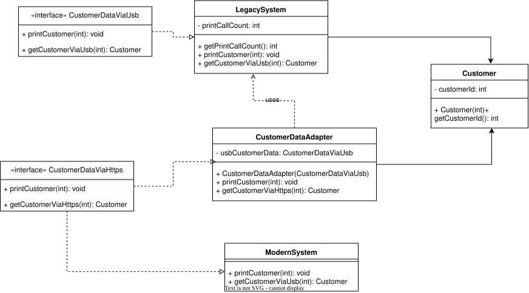

| CS-665       | Software Design & Patterns |
|--------------|----------------------------|
| Name         | Laya Dang                  |
| Date         | 11/10/2026                 |
| Course       | Fall 2026                  |
| Assignment # | 4.                         |

# Assignment Overview

This assignment demonstrates an integration of a legacy system with a modern system using the Adapter design pattern.

## Prerequisites

This project requires:

- Java 25 JDK
- Apache Maven 3.9 or newer

# GitHub Repository Link

https://github.com/pd03-cs-665/assignment-4

# Implementation Description 

> Explain the level of flexibility in your implementation, including how new object types can be easily added or removed in the future.

The adapter design pattern allows for flexibility by decoupling the client code from the legacy system implementation. Because the adapter interface only relies on the modern interface, we do not have to change anything about the legacy system, the adaptee. Any client interactions with the legacy system can use the same API and interface as the modern system.

> Discuss the simplicity and understandability of your implementation, ensuring that it is easy for others to read and maintain.

Because of this decoupling between the client interaction and the legacy system, it is simple and straightforward from the client's point-of-view, allowing them to only be concerned about one interface (the modern one). From a developer's perspective, the maintainability is much improved with the Adapter pattern, because the legacy system's interface is completely replaced with a modern API. Any future system intergration can also implement from the modern system interface, without affecting what current adapters exists.

> Describe how you have avoided duplicated code and why it is important.

Instead of creating a new layer to integrate the legacy system with client code, this assignment implements the already exisiting modern interface, so that the two can share the same API.

> If applicable, mention any design patterns you have used and explain why they were chosen.

This assignment uses the Adapter design pattern, as we need a bridge between two interfaces, especially since the legacy and modern system interface code cannot be changed.

# UML Diagram



# Maven Commands

We'll use Apache Maven to compile and run this project.

## Compile

```bash
mvn clean compile
```

## JUnit Tests

```bash
mvn clean test
```

## Spotbugs 

```bash
mvn spotbugs:gui
```

## Checkstyle 

```bash
mvn checkstyle:checkstyle
```
